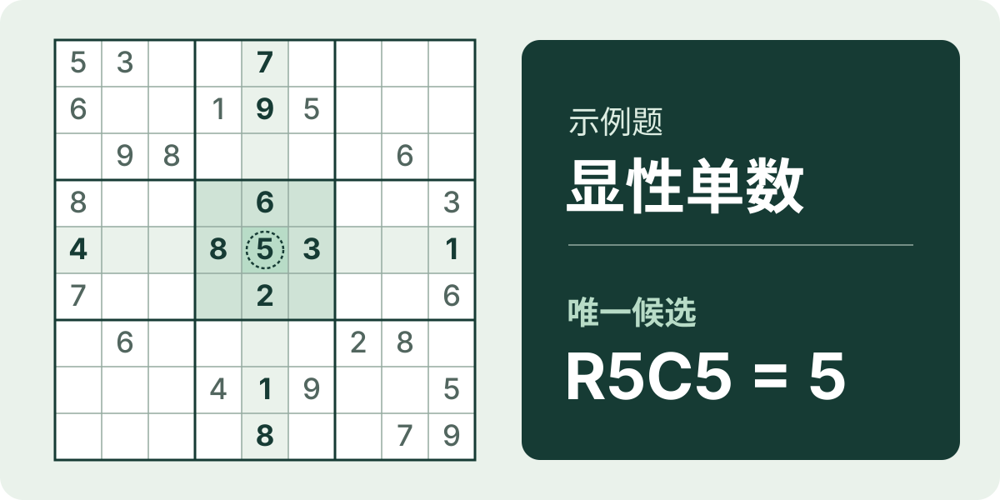

# HoDoKu macOS 原生版

在 Mac 上出题、解数独和练习解题技巧。遇到卡关时，逐步查看提示的依据，也可以记录和回放自己的解题过程。

**[下载 Apple Silicon DMG](https://github.com/LoveMu-498/hodoku-macos-native/releases/download/v2.4.0-beta.1/HoDoKu-Native-2.4.0-beta.1-AppleSilicon.dmg)**　[发行说明与校验文件](https://github.com/LoveMu-498/hodoku-macos-native/releases/tag/v2.4.0-beta.1)

`2.4.0 Beta 1` 为公开预览版，采用 ad-hoc 签名，未经 Apple 公证。

## 看懂下一步

以仓库自带的示例题为例，中心格所在的行、列和九宫格已经排除了其他数字，因此只剩候选 **5**。HoDoKu 可以逐层展开这类提示，读完后由你决定是否应用这一步。

- **出题与训练** — 选择难度，按目标技巧出题练习。
- **批注与分享** — 在棋盘上标色、圈叉、画链，将题目或棋盘图片分享出去。
- **回放与续解** — 回看解题步骤，从某一帧另开一局，保留原来的回放。

[工作台操作](native/app/BUILD.md#使用工作台)

## 安装与继续作答

1. 确认 Mac 使用 **Apple Silicon（arm64）**。构建部署下限为 macOS 11.0，首发实测环境为 M3 Pro／macOS 27.3。
2. 已安装原生试用版时，先退出并备份数据目录。新版本沿用原生作答数据，也可按规则只读导入 Java 旧档。[数据目录与迁移](INSTALL.md)
3. 核对发行页提供的 SHA-256，打开 DMG，将 **HoDoKu Native.app** 拖入「应用程序」。DMG 自带运行库，应用可离线使用，无需安装 Java、Rust、Homebrew 或 Xcode。

若 macOS 阻止首次打开，请查看安装说明。各版本的实测范围和已知问题见对应的发行说明。[安装说明](INSTALL.md)　[所有发行版](https://github.com/LoveMu-498/hodoku-macos-native/releases)

## 构建、来源与许可

工作台使用 Swift、AppKit 和 SwiftUI，Rust 引擎负责求解、评分与出题。[从源码构建](native/app/BUILD.md)　[变更记录](CHANGES.md)

本项目是 Bernhard Hobiger 原版 HoDoKu 的非官方衍生项目，延续 PseudoFish 的 Java 维护版和 HoDoKu macOS Java 版。应用按 **GPL-3.0-or-later** 发布，每个 DMG 的对应源码随同版本提供。[上游归属](UPSTREAM.md)　[许可证](COPYING)　[第三方组件](THIRD_PARTY_NOTICES.md)
